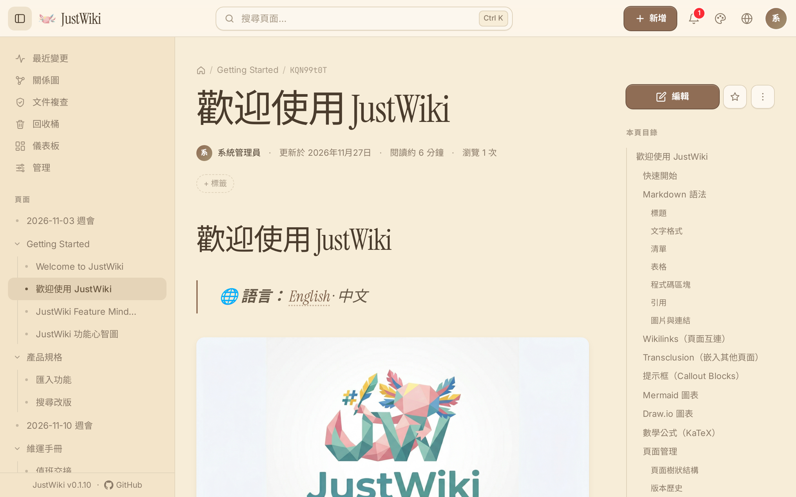
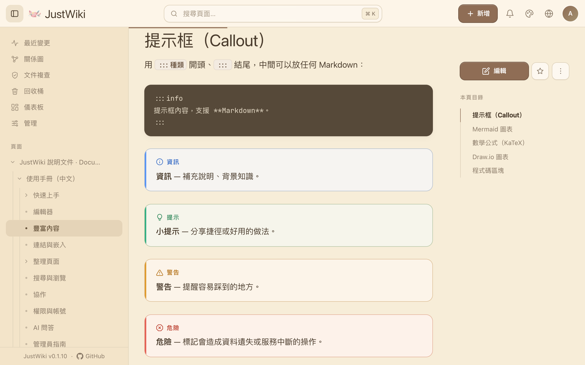
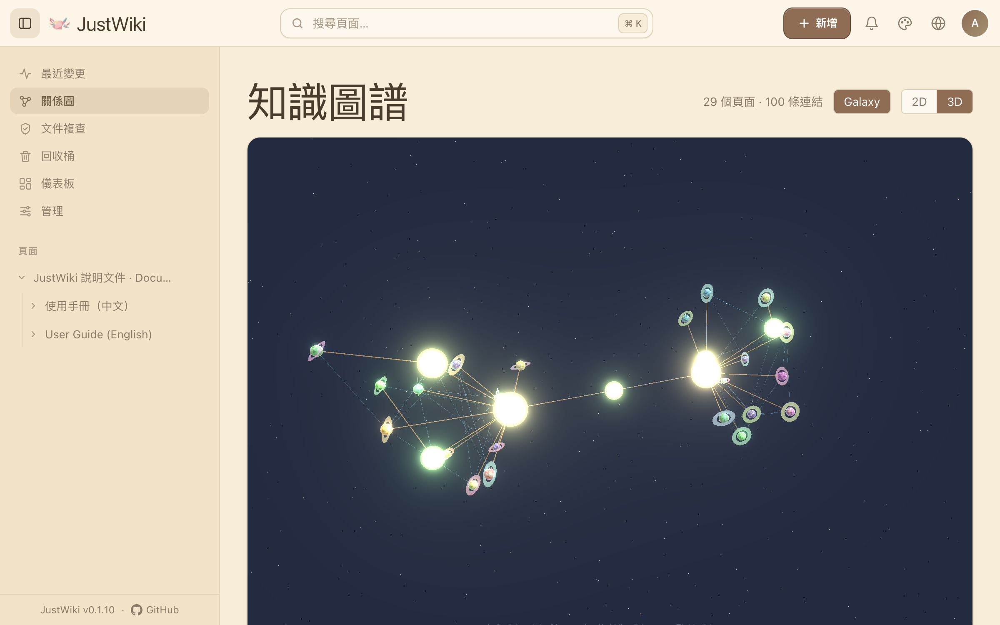
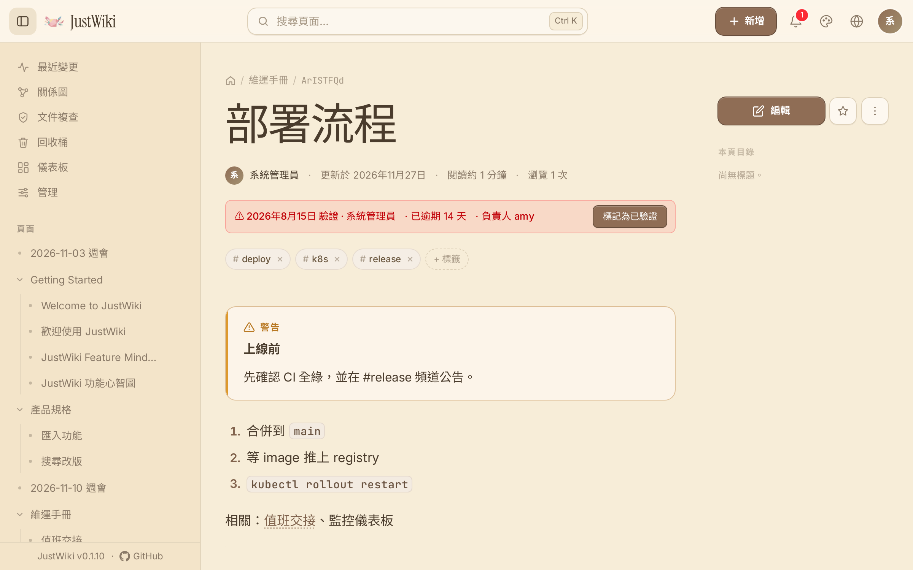
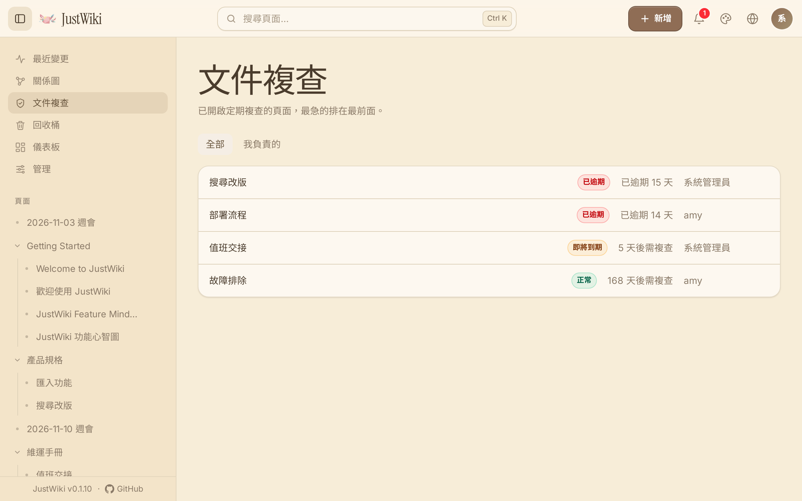
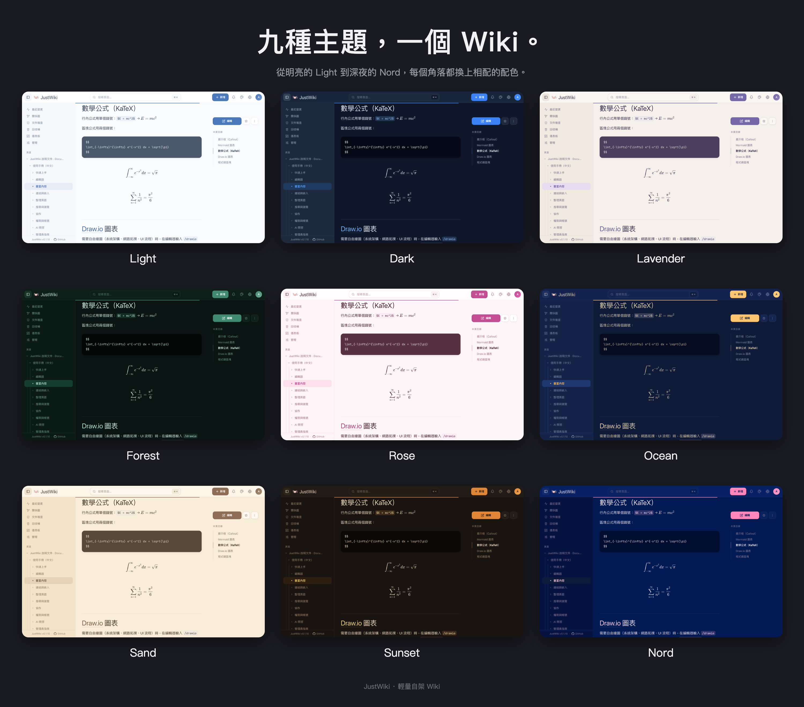
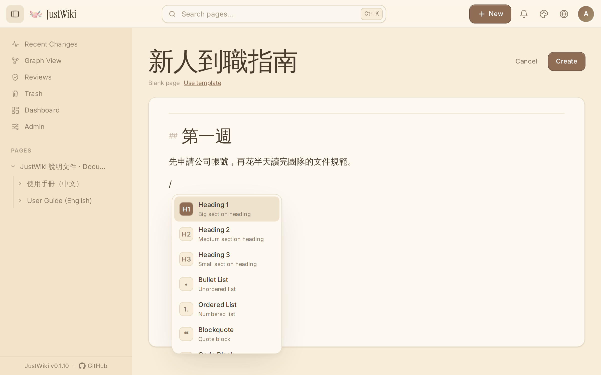
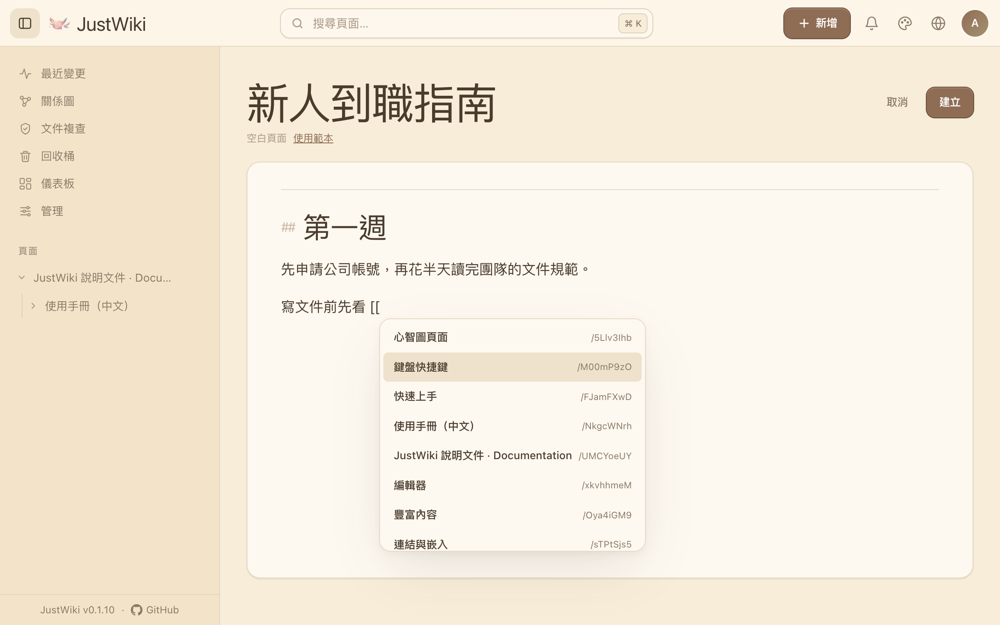
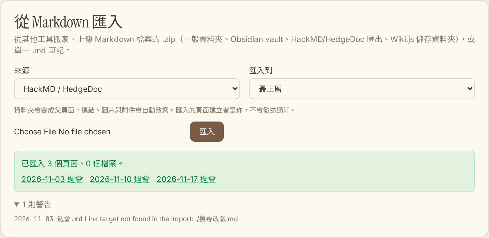

# JustWiki

一套輕量、自架式的小團隊 Wiki。Clone 下來、執行，就能開始寫。

**線上試用**：[codingman.cc/JustWiki](https://codingman.cc/JustWiki/)（唯讀示範，不用安裝）

<p align="center">
  
</p>

<p align="center">
  <strong>中文</strong> · <a href="README.en.md">English</a>
</p>

## 為什麼選 JustWiki

專為「小團隊、不想碰維運」的情境設計：

- **vs Outline** — 不用 PostgreSQL、Redis、MinIO，也不用 4 CPU / 8 GB 機器；一台 1 vCPU / 512 MB VM 或樹莓派就能跑
- **vs Wiki.js** — v3 自 2021 宣布至今仍無正式版、v2 進入 maintenance；JustWiki 持續更新
- **vs BookStack** — 頁面可無限巢狀，不是 Book → Chapter → Page 三層到底
- **vs Notion / Obsidian** — 自架、資料在自己機器、完整多人協作（ACL、留言、訂閱通知），不是雲端鎖定或單機筆記

所有資料 = 一個 `data/just-wiki.db` SQLite 檔 + `media/` 目錄。備份、搬家、匯出都只是複製檔案。

## 功能特色

**編輯與內容**
- **Markdown 優先、所見即所得** — Milkdown 編輯器讓非工程師直接寫，但底層儲存仍是純 Markdown，工程師能用 Git/腳本處理、備份不被綁定在自家格式
- **Slash 指令與多種區塊** — Mermaid 流程圖、KaTeX 數學公式、Callout 提示框
- **Wikilinks** — `[[頁面]]` 語法快速連結，自動追蹤反向連結（backlinks）
- **頁面階層與範本** — 巢狀頁面結構、常用範本一鍵套用
- **Draw.io 整合** — 內建圖表編輯器

<p align="center">
  
</p>

**檢視與搜尋**
- **多種檢視模式** — 樹狀、圖譜（Graph，支援 3D 與平面切換）
- **全文搜尋** — FTS5 驅動，原生支援 CJK

<p align="center">
  
</p>

**AI 問答（可選）**
- **以 wiki 為知識來源** — RAG 自動檢索相關頁面，回答底部顯示引用連結
- **權限敏感** — 遵循 ACL，模型只讀得到使用者本身有權閱讀的頁面
- **自選模型** — 任何 OpenAI 相容端點都可接（OpenAI、Gemini、Ollama、Groq、DeepSeek…）

**協作與權限**
- **多使用者 + 群組 ACL** — 頁面層級的權限控制（權限由父頁面繼承），分為閱讀、編輯、管理三級；只有「管理」權限能改頁面的可見範圍（ACL、公開分享、搬到別的空間）
- **併發編輯保護** — 樂觀鎖機制（`base_version`），多人同時編輯不會默默互蓋
- **版本歷史** — 每頁修訂紀錄與差異比對，改壞了能回滾
- **草稿自動儲存** — 編輯中的內容自動存在瀏覽器，關掉分頁或當機後回來可以還原
- **文件定期複查** — 為頁面指定負責人與複查週期，到期自動提醒；頁面上顯示最後驗證時間，另有「文件複查」清單列出逾期頁面
- **留言、書籤、標籤、頁面訂閱** — 小團隊協作夠用
- **活動紀錄與垃圾桶** — 近況一目了然、刪除採軟刪除可救回
- **SSO 與 API Token** — 內建 OIDC（Google、GitHub、自訂）、LDAP、個人 Bearer Token，可整合企業帳號系統與自動化腳本

<p align="center">
  
</p>

<p align="center">
  
</p>

**匯入、匯出與部署**
- **從其他工具搬家** — 一次匯入 Markdown 資料夾、Obsidian vault、HackMD / HedgeDoc、Wiki.js 2.x（[說明](#從其他工具搬家)）
- **多格式匯出** — 單頁匯出為 Markdown / HTML / PDF（瀏覽器列印），整站打包為靜態 zip
- **單一 SQLite 檔案** — 免外部資料庫，備份就是複製一個檔案
- **佈景主題** — 內建 9 款配色（[預覽](#佈景主題)）
- **Docker 部署** — 一句 `docker-compose up` 搞定

## 佈景主題

<p align="center">
  
</p>

內建 9 款精選配色 — **Light、Dark、Lavender、Forest、Rose、Ocean、Sand、Sunset、Nord**。隨時可以從右上角的主題選單切換，選擇會依瀏覽器記住。

## 部署方式

### Docker (推薦)

使用 Docker Compose 是啟動 JustWiki 最快的方式。

```bash
cp .env.example .env
# 編輯 .env — 至少要修改 SECRET_KEY 與 ADMIN_PASS
docker-compose up -d
```

開啟 http://localhost:3000 即可開始使用。

JustWiki 是單一 image（`ghcr.io/pttcodingman/justwiki`），API 與前端由同一個容器提供，不需要 Compose 也能直接跑：

```bash
docker run -d --name justwiki -p 3000:8000 -v ./data:/app/data \
  -e SECRET_KEY=<random-string> -e ADMIN_PASS=<strong-password> \
  -e PUBLIC_BASE_URL=http://localhost:3000 \
  ghcr.io/pttcodingman/justwiki:latest
```

> **放在自己的 reverse proxy 後面**（Caddy、Traefik、nginx…）：在 `.env` 設定 `TRUST_PROXY=true`，並用 `PUBLIC_BASE_URL_DOCKER` 填入對外網址（例如 `https://wiki.example.com`）。
>
> **從舊版（backend + frontend 兩個 image）升級**：改用新版 `docker-compose.yml` 後執行 `docker-compose up -d --remove-orphans`。資料目錄 `./data` 與對外 port 3000 都不變；舊版 compose 會強制開啟 `TRUST_PROXY`，新版不會，若前面有 proxy 請自行在 `.env` 設定。

### 開放到外網之前

只要看起來不是本機開發（在 Docker 裡執行、`PUBLIC_BASE_URL` 不是 localhost、有設 `ALLOWED_ORIGINS` 或 `COOKIE_SECURE`），JustWiki 遇到不安全的設定就會**拒絕啟動**：

- `SECRET_KEY` 還是預設值 → 不啟動，錯誤訊息會附一組隨機金鑰給你用。
- 管理員密碼是 `admin`、`password` 這類預設弱密碼 → 不啟動；把 `ADMIN_PASS` 設成強密碼後重啟，就會用它取代資料庫裡的弱密碼。

其餘建議：

- 一定要走 HTTPS。`PUBLIC_BASE_URL` 設成 `https://…` 時會自動加上 Secure cookie 與 HSTS。
- `ALLOWED_ORIGINS` 填對外網址，跨站請求才會被擋下。
- `TRUST_PROXY` 只在前面真的有 reverse proxy 時開，否則任何人都能偽造 IP 繞過登入限速。
- `ANONYMOUS_READ` 預設關閉；打開後未登入的訪客能讀所有沒設 ACL 的頁面。
- 登入只有每個 IP 每分鐘 5 次的限速，沒有帳號鎖定或兩步驟驗證。對外開放時建議在前端（Cloudflare、反向代理）再加一層限速或存取控制，或改用 SSO 登入。

### 設定

所有設定都集中在單一 `.env` 檔案。完整選項請參考 [.env.example](.env.example)。

主要變數：

| 變數              | 說明                          | 預設值                |
| ----------------- | ----------------------------- | --------------------- |
| `SECRET_KEY`      | Session 簽章金鑰（正式環境必改） | `change-me-...`       |
| `ADMIN_USER`      | 管理員帳號                    | `admin`               |
| `ADMIN_PASS`      | 首次啟動時的管理員密碼（正式環境必改） | `admin`               |
| `PUBLIC_BASE_URL` | 對外網址，用於 SSO 回呼與判斷是否為正式環境 | `http://localhost:8000` |
| `ALLOWED_ORIGINS` | 允許的來源網址（CSRF / CORS），逗號分隔 | —                     |
| `COOKIE_SECURE`   | Cookie 只走 HTTPS（`PUBLIC_BASE_URL` 是 https 時自動開啟） | `false`               |
| `TRUST_PROXY`     | 從 `X-Forwarded-For` 取得真實 IP，前面有 proxy 時才開 | `false`               |
| `ANONYMOUS_READ`  | 允許未登入訪客閱讀未設 ACL 的頁面 | `false`               |
| `DB_PATH`         | SQLite 資料庫路徑             | `./backend/data/just-wiki.db` |
| `AI_ENABLED`      | 啟用 AI 問答功能              | `false`               |
| `AI_API_KEY`      | LLM 供應商 API 金鑰（啟用時必填） | —                     |

## 使用指南

### Slash 指令

<p align="center">
  
</p>

在編輯器中輸入 `/` 即可開啟 slash 選單，輸入後續文字可即時篩選。

| 指令 | 說明 |
| ---- | ---- |
| `/h1` | 標題 1 — 大段落標題 |
| `/h2` | 標題 2 — 中段落標題 |
| `/h3` | 標題 3 — 小段落標題 |
| `/bullet` | 無序清單 |
| `/ordered` | 有序清單 |
| `/quote` | 引用區塊 |
| `/code` | 程式碼區塊 |
| `/hr` | 分隔線 |
| `/callout-info` | 資訊提示框（`:::info`） |
| `/callout-warning` | 警告提示框（`:::warning`） |
| `/callout-tip` | 技巧提示框（`:::tip`） |
| `/callout-danger` | 危險提示框（`:::danger`） |
| `/mermaid` | Mermaid 圖表 |
| `/math` | KaTeX 數學公式 |
| `/drawio` | Draw.io 圖表 |

### Wikilinks 自動補全

<p align="center">
  
</p>

在編輯器中輸入 `[[` 即會跳出頁面搜尋下拉，繼續輸入即時篩選；按 ↑ ↓ 選擇、Enter 插入。系統會自動建立反向連結，讓你在頁面底部的 **LINKED FROM** 區塊看到所有引用來源。

### 從其他工具搬家

管理員可在 **管理 → 從 Markdown 匯入** 上傳 `.zip`（或單一 `.md`），並選擇要匯入到哪個頁面底下。

<p align="center">
  
</p>

支援的來源：

| 來源 | 會轉換的內容 |
| --- | --- |
| **Markdown 資料夾**（GitHub、MkDocs、Docusaurus…） | 資料夾 → 父頁面（`index.md` / `README.md` 當資料夾頁），相對 `.md` 連結 → wikilink，圖片與附件上傳到媒體庫，常見 HTML 轉成 Markdown，`:::note` 等提示區塊 |
| **Obsidian vault**（自動偵測 `.obsidian/`） | `[[筆記]]`、別名、`![[圖片]]`、`![[筆記]]` 嵌入、`> [!note]` callout、`#標籤`、`%%註解%%`、換行規則依 vault 的 Strict line breaks 設定 |
| **HackMD / HedgeDoc** | 第一個 H1 當標題、`###### tags:`、`:::success` / `:::spoiler`、`` 等嵌入、`[TOC]` |
| **Wiki.js 2.x**（「本機檔案系統」或 Git 儲存的資料夾，自動偵測） | 頁面路徑 → 階層，`title` / `tags` 等 metadata，絕對路徑連結與 `/uploads` 圖片、語系資料夾，`{.is-info}` 提示區塊，視覺編輯器的 `.html` 頁面轉成 Markdown，`diagram` 區塊轉成 SVG 圖片 |

找不到目標的連結會保留文字並列在匯入報告中。頁面建立者為執行匯入的管理員，不會發送通知；原始的作者、時間與版本歷史不會搬過來。

---

## 開發者指南

### 技術堆疊

| 層級     | 技術                                           |
| -------- | ---------------------------------------------- |
| 後端     | Python、FastAPI、aiosqlite、Pydantic           |
| 前端     | React 19、Vite、Tailwind CSS 4、Zustand        |
| 編輯器   | Milkdown（ProseMirror）                        |
| 資料庫   | SQLite（單一檔案）                             |
| 部署     | Docker Compose                                 |

### 本地開發

1. **環境設定**: 安裝後端與前端依賴、建立 `.env`
   ```bash
   make setup
   ```
   *需求環境：Python 3.11+、Node.js 20+、[uv](https://docs.astral.sh/uv/)*

2. **啟動開發伺服器**: 同時啟動後端（port 8000）與前端 Vite dev server（port 5173）
   ```bash
   make dev
   ```

### Makefile 指令

| 指令 | 說明 |
| ---- | ---- |
| `make dev` | 以開發模式啟動後端與前端 |
| `make dev-backend` | 只啟動後端 |
| `make dev-frontend` | 只啟動前端 |
| `make build` | 建置前端 production 版本 |
| `make backup` | 依時間戳備份 SQLite 資料庫 |
| `make clean` | 清除資料庫、媒體檔與前端 dist |
| `make docker-up` | 執行 `docker-compose up -d` |
| `make docker-down` | 執行 `docker-compose down` |
| `make setup` | 首次設定（安裝依賴、建立 .env） |

### 專案結構

```
justwiki/
├── backend/          # FastAPI REST API
│   └── app/
│       ├── main.py
│       ├── routers/  # pages, search, media, tags, versions, ...
│       └── services/ # markdown, search, AI, webhook, export
├── frontend/         # React SPA (Vite)
│   └── src/
│       ├── components/
│       │   ├── Editor/   # Milkdown 編輯器
│       │   ├── Viewer/   # Markdown 渲染器
│       │   ├── Search/   # 搜尋
│       │   └── Layout/   # Sidebar、Navbar
│       ├── pages/
│       ├── hooks/
│       └── store/        # Zustand
├── data/             # 執行期資料（SQLite、媒體檔）
├── docker-compose.yml
├── Makefile
└── .env.example
```

## 授權

本專案以 [MIT License](LICENSE) 授權釋出。
