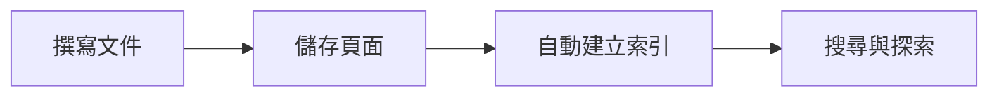
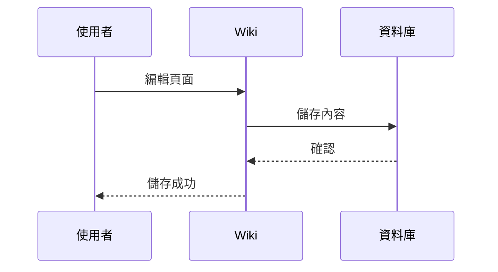

# 歡迎使用 JustWiki

> 🌐 **語言：** [[welcome|English]] · 中文


JustWiki 是一套輕量、自架式的團隊知識庫系統。以 Markdown 為核心，所有資料存放在單一 SQLite 檔案，不需要外部資料庫，幾分鐘就能上手。

這篇文章會帶你認識所有功能，你可以隨時編輯或刪除它。

---

## 快速開始

1. 按下左側邊欄的 **＋ 新增頁面** 或使用快捷鍵 `Ctrl+N`
2. 輸入標題與內容（支援 Markdown）
3. 儲存後就會出現在頁面列表中

:::tip
你也可以在新增頁面時選擇 **模板**（如會議記錄、技術文件、ADR 等），系統已內建多種常用模板。
:::

---

## Markdown 語法

JustWiki 完整支援 GitHub Flavored Markdown (GFM)，以下是常用語法範例：

### 標題

```
# 一級標題
## 二級標題
### 三級標題
```

### 文字格式

| 語法 | 效果 |
|------|------|
| `**粗體**` | **粗體** |
| `*斜體*` | *斜體* |
| `` `行內程式碼` `` | `行內程式碼` |
| `~~刪除線~~` | ~~刪除線~~ |

### 清單

```
- 無序清單項目
- 另一個項目
  - 巢狀項目

1. 有序清單
2. 第二項

- [x] 已完成任務
- [ ] 待辦任務
```

效果：

- [x] 已完成任務
- [ ] 待辦任務

### 表格

```
| 欄位 A | 欄位 B | 欄位 C |
|--------|--------|--------|
| 資料 1 | 資料 2 | 資料 3 |
```

### 程式碼區塊

支援語法高亮，在程式碼開頭標記語言名稱即可：

```python
def hello():
    print("Hello, JustWiki!")
```

```javascript
const greet = () => console.log("Hello!");
```

### 引用

> 這是一段引用文字。
> 可以跨行。

### 圖片與連結

```
[連結文字](https://example.com)

```

---

## Wikilinks（頁面互連）

使用雙方括號即可快速連結到其他頁面：

```
連到另一頁：[[page-slug]]
自訂顯示文字：[[page-slug|顯示文字]]
```

- 在編輯器中輸入 `[[` 會自動跳出頁面搜尋提示
- 系統會自動追蹤頁面之間的反向連結（backlinks），在頁面底部顯示

---

## Transclusion（嵌入其他頁面）

使用 `![[slug]]` 可以把另一個頁面的內容就地嵌入進來，來源頁更新時會即時同步：

```
![[page-slug]]
![[page-slug|自訂顯示標題]]
```

常見用途是把散落在子頁的段落彙整成一個「目錄頁」或「週報總覽」，避免複製貼上後資訊不同步。

---

## 提示框（Callout Blocks）

使用 `:::` 語法可以建立醒目的提示框：

:::info
這是一個 **資訊** 提示框，適合補充說明。
:::

:::warning
這是一個 **警告** 提示框，提醒需要注意的事項。
:::

:::tip
這是一個 **提示** 框，分享小技巧。
:::

:::danger
這是一個 **危險** 提示框，標記可能造成問題的操作。
:::

語法範例：

```
:::info
提示框內容，支援 **Markdown** 格式。
:::
```

---

## Mermaid 圖表

使用 Mermaid 語法即可直接在頁面中繪製流程圖、序列圖等：





支援的圖表類型包括：flowchart、sequence、class、state、gantt、pie 等。

---

## Draw.io 圖表

需要更自由的繪圖時，在編輯器輸入 `/drawio` 就能開啟內建的 Draw.io 編輯器，適合畫系統架構圖、UI 流程圖、網路拓撲等。圖表以 `::drawio[id]` 語法嵌入頁面，之後點擊圖表即可重新開啟編輯器修改——不需要離開 JustWiki，也不用管理圖檔版本。

---

## 數學公式（KaTeX）

在內容前後各加上兩個錢號即可顯示數學公式：

行內公式：$E = mc^2$

區塊公式：

$$
\int_{-\infty}^{\infty} e^{-x^2} dx = \sqrt{\pi}
$$

$$
\sum_{n=1}^{\infty} \frac{1}{n^2} = \frac{\pi^2}{6}
$$

---

## 頁面管理

### 頁面樹狀結構

頁面可以設定 **父頁面**，形成階層式結構。左側邊欄會以樹狀方式顯示所有頁面。

### 版本歷史

每次儲存都會自動建立版本紀錄，你可以：
- 查看歷史版本列表
- 比較任意兩個版本之間的差異（diff）
- 回溯到任何歷史版本

### 標籤（Tags）

為頁面加上標籤方便分類與篩選，首頁會顯示所有標籤供快速瀏覽。

---

## 搜尋

按下 `Ctrl+K` 開啟搜尋面板，支援：
- 全文搜尋（使用 SQLite FTS5 引擎）
- 中日韓文字分詞搜尋
- 依標籤篩選

---

## 媒體上傳

- 在編輯器中直接 **貼上圖片** 即可自動上傳
- 也可以透過 **拖曳** 上傳圖片
- 預設支援最大 20MB 的檔案（管理員可在「管理 → 網站設定」調整）

---

## 圖譜檢視（Graph View）

點擊側邊欄的 **圖譜** 可以看到所有頁面之間的連結關係，以互動式力導向圖呈現。透過 wikilinks 建立的連結會以線條顯示，方便你探索知識之間的關聯。

---

## 書籤與留言

- **書籤**：在任何頁面點擊書籤圖示即可收藏，方便快速存取
- **留言**：每個頁面下方都有留言區，適合團隊討論

---

## 鍵盤快捷鍵

| 快捷鍵 | 功能 |
|--------|------|
| `Ctrl+N` | 新增頁面 |
| `Ctrl+K` | 開啟搜尋 |
| `Ctrl+E` | 切換編輯 / 檢視模式 |

---

## 佈景主題

JustWiki 內建多種主題（亮色、暗色、薰衣草、森林等），可在設定中自由切換，偏好會自動記住。

---

## 頁面類型

除了一般的 Markdown 文件頁面，JustWiki 也支援其他頁面類型：

- **Mindmap（心智圖）** — 把 Markdown 標題或項目清單即時渲染成左右分支的心智圖，讀者可以切換不同配色方案

建立頁面時從上方的 **📄 Document / 🧠 Mindmap** 切換即可。範例：[[welcome-mindmap-zh|JustWiki 功能心智圖]]

---

## 範本系統

建立頁面時可以直接套用系統內建的範本，讓團隊文件風格一致：

- **會議記錄** — 議程、決議、追蹤項目
- **技術文件** — 概述 / 架構 / API / 注意事項
- **Troubleshooting** — 症狀、原因、解決步驟
- **ADR** — 架構決策紀錄（Architecture Decision Record）

管理員可在 **Admin → Templates** 新增或修改範本，整個團隊共用同一組樣板。

---

## 權限與群組（ACL）

JustWiki 提供頁面層級的權限控制：

- 權限等級由高至低：`admin > write > read > none`
- 每個頁面可為指定 **使用者** 或 **群組** 設定權限
- 未明確設定的頁面會沿用 **上層頁面** 的權限（繼承）
- 管理員角色自動擁有全域存取權（admin bypass）
- viewer 角色即使被授予 write，也會被降級為 read

群組在 **Admin → Groups** 建立與維護成員；個別頁面的 ACL 在頁面選單的 **權限管理** 中設定。

---

## 訂閱與通知

在任何頁面按下 **👁 訂閱** 圖示，當頁面被編輯、收到新留言、或被其他頁面連結時，右上角的通知鈴鐺就會即時提醒你。點擊通知即可標記為已讀。

---

## 活動紀錄與垃圾桶

- **活動紀錄** — 側邊欄的「最近活動」顯示整個 wiki 的編輯、新增、刪除操作，方便掌握團隊動態
- **垃圾桶** — 刪除頁面採用 soft delete，先進入垃圾桶而非立即清除；管理員可在 **Admin → Trash** 還原或永久清除

還原的頁面會自動重建搜尋索引與反向連結，不需要手動整理。

---

## AI 問答（可選功能）

啟用 `AI_ENABLED=true` 後，側邊欄會出現 **AI 助理**：

- **RAG 檢索** — 以 wiki 頁面為知識來源，回答底部會列出引用的頁面
- **權限敏感** — 模型只能讀到你本人有權閱讀的頁面，不會越權洩漏
- **自選模型** — 相容於任何 OpenAI 介面的服務（OpenAI、Gemini、Ollama、Groq、DeepSeek 等）

---

## 匯出與公開頁面

- **單頁匯出** — 頁面選單的「匯出」可輸出 **Markdown / HTML / PDF**（PDF 透過瀏覽器列印對話框）
- **整站打包** — 管理員可在 **Admin → Export** 把整個 wiki 打包成 zip
- **公開頁面** — 管理員把頁面標記為「公開」後，其他人可以透過 `/public/slug` 網址在未登入的情況下閱讀；匿名 API 有 60 req/min/IP 的速率限制保護

---

## 登入方式

JustWiki 支援多種登入整合，讓你沿用團隊既有的帳號系統：

- **本機帳號** — 預設的帳號密碼登入，密碼以 bcrypt 雜湊
- **OIDC SSO** — Google、GitHub、以及任何 OIDC 標準的自建 IdP，採用 PKCE
- **LDAP** — 綁定企業目錄，屬性自動映射
- **邀請制** — 啟用後只有被管理員邀請的 Email 才能註冊登入
- **個人 API Token** — 在 **個人資料 → API Tokens** 建立可撤銷的 Bearer token，適合給 CI 或腳本使用；token 明文只在建立當下顯示一次

---

## 同時編輯的保護（Optimistic Locking）

同一頁面被兩人同時編輯時，後儲存的一方會拿到 409 Conflict 而不是直接覆蓋對方的修改。畫面會提示版本差異，讓你可以重新合併編輯內容——避免無聲的 lost update。

---

## 管理功能

管理員可以在 **Admin** 選單進入以下頁面：

- **使用者** — 新增帳號、指派角色、停用或刪除
- **群組** — 建立群組、管理成員
- **範本** — 建立與修改全域範本
- **垃圾桶** — 還原或永久清除被刪除的頁面
- **匯出** — 把整個 wiki 打包成 zip
- **備份** — 觸發 SQLite 資料庫備份

---

## 部署方式

JustWiki 使用 Docker Compose 部署，包含：
- **後端**：FastAPI + uvicorn（port 8000）
- **前端**：React + nginx（port 3000）
- 共用 `./data` 目錄存放 SQLite 資料庫與上傳檔案

所有設定透過 `.env` 檔案管理。

---

:::info
這篇文章本身就是用 JustWiki 的 Markdown 功能撰寫的，你可以點擊右上角的編輯按鈕查看原始碼，或隨時修改、刪除這篇文章。
:::

祝你使用愉快！
