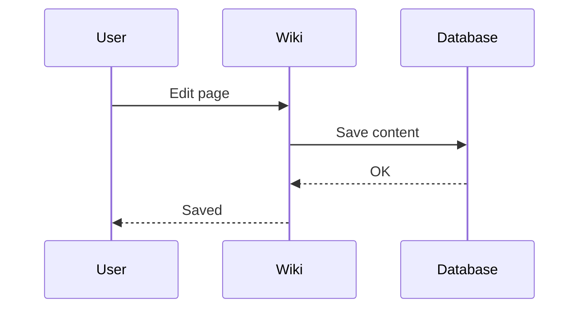

# Welcome to JustWiki

> 🌐 **Language:** English · [[welcome-zh|中文]]


JustWiki is a lightweight, self-hosted knowledge base for small teams. Built around Markdown and backed by a single SQLite file, it needs no external database — you can be up and running in minutes.

This page walks you through every feature. Feel free to edit or delete it at any time.

---

## Quick Start

1. Click **＋ New Page** in the left sidebar or press `Ctrl+N`
2. Enter a title and content (Markdown is supported)
3. Save, and the page will appear in the sidebar tree

:::tip
When creating a page you can also pick a **template** (meeting notes, tech spec, ADR, troubleshooting, etc.). Several common templates are built in.
:::

---

## Markdown Syntax

JustWiki fully supports GitHub Flavored Markdown (GFM). Here are the most common examples:

### Headings

```
# Heading 1
## Heading 2
### Heading 3
```

### Text Formatting

| Syntax | Result |
|--------|--------|
| `**bold**` | **bold** |
| `*italic*` | *italic* |
| `` `inline code` `` | `inline code` |
| `~~strikethrough~~` | ~~strikethrough~~ |

### Lists

```
- Unordered item
- Another item
  - Nested item

1. Ordered list
2. Second item

- [x] Completed task
- [ ] Pending task
```

Rendered:

- [x] Completed task
- [ ] Pending task

### Tables

```
| Column A | Column B | Column C |
|----------|----------|----------|
| Data 1   | Data 2   | Data 3   |
```

### Code Blocks

Syntax highlighting is enabled — just label the language after the opening fence:

```python
def hello():
    print("Hello, JustWiki!")
```

```javascript
const greet = () => console.log("Hello!");
```

### Blockquotes

> This is a blockquote.
> It can span multiple lines.

### Images and Links

```
[Link text](https://example.com)

```

---

## Wikilinks (Page Cross-Links)

Use double square brackets to link between pages:

```
Link to another page: [[page-slug]]
Custom display text:  [[page-slug|Display Text]]
```

- Typing `[[` inside the editor opens a page autocomplete popup
- Backlinks are tracked automatically and shown at the bottom of each page

---

## Transclusion (Embedding Other Pages)

Use `![[slug]]` to embed another page's content inline — the embed stays in sync with its source:

```
![[page-slug]]
![[page-slug|Custom Heading]]
```

Handy for building "index" or "weekly roundup" pages that pull fragments from scattered child pages without the copy-paste drift.

---

## Callout Blocks

Use the `:::` syntax to create highlighted callouts:

:::info
This is an **info** callout — great for supplementary notes.
:::

:::warning
This is a **warning** callout — flag things that need attention.
:::

:::tip
This is a **tip** callout — share small tricks and shortcuts.
:::

:::danger
This is a **danger** callout — mark risky or destructive operations.
:::

Syntax:

```
:::info
Callout content. **Markdown** is supported inside.
:::
```

---

## Mermaid Diagrams

Draw flowcharts, sequence diagrams and more right in the page using Mermaid:




Supported diagram types include flowchart, sequence, class, state, gantt, pie and more.

---

## Draw.io Diagrams

When you need richer drawing — system architecture, UI flows, network topologies — type `/drawio` in the editor to open the built-in Draw.io editor. Diagrams are embedded with the `::drawio[id]` syntax; clicking one re-opens the editor for edits. Everything stays inside JustWiki, so there is no separate diagram file to version.

---

## Math (KaTeX)

Wrap content in double dollar signs to render math:

Inline: $E = mc^2$

Block:

$$
\int_{-\infty}^{\infty} e^{-x^2} dx = \sqrt{\pi}
$$

$$
\sum_{n=1}^{\infty} \frac{1}{n^2} = \frac{\pi^2}{6}
$$

---

## Page Management

### Page Tree

Pages can have a **parent page**, forming a hierarchy. The left sidebar displays everything as a tree.

### Version History

Every save creates a new version. You can:
- Browse all past versions of a page
- Diff any two versions side by side
- Revert to any previous version

### Tags

Attach tags to pages for easy categorisation and filtering. The home page lists every tag for quick browsing.

---

## Search

Press `Ctrl+K` to open the search panel. It supports:
- Full-text search (powered by SQLite FTS5)
- CJK tokenisation for Chinese / Japanese / Korean
- Filter by tag

---

## Media Uploads

- **Paste images** directly into the editor to auto-upload
- **Drag and drop** files onto the editor
- Maximum file size: 20 MB by default (admins can change it under Admin → Site settings)

---

## Graph View

Click **Graph** in the sidebar to see all pages and their relationships as an interactive force-directed graph. Every wikilink becomes an edge, making it easy to explore how your knowledge is connected.

---

## Bookmarks and Comments

- **Bookmarks** — click the bookmark icon on any page to pin it for quick access
- **Comments** — every page has a comments section for team discussion

---

## Keyboard Shortcuts

| Shortcut | Action |
|----------|--------|
| `Ctrl+N` | New page |
| `Ctrl+K` | Open search |
| `Ctrl+E` | Toggle edit / view mode |

---

## Themes

JustWiki ships with multiple built-in themes (Light, Dark, Lavender, Forest, and more). Switch from the theme picker — your choice is remembered per browser.

---

## Page Types

Beyond plain Markdown document pages, JustWiki supports other page types:

- **Mindmap** — renders Markdown headings or bullet lists into a left-to-right mindmap on the fly; readers can switch color palettes

When creating a page, toggle **📄 Document / 🧠 Mindmap** at the top. Example: [[welcome-mindmap|JustWiki Feature Mindmap]]

---

## Templates

Apply one of the built-in templates when creating a page to keep team docs consistent:

- **Meeting notes** — agenda, decisions, action items
- **Tech spec** — overview / architecture / API / caveats
- **Troubleshooting** — symptom, cause, resolution steps
- **ADR** — Architecture Decision Record

Admins can add or tweak templates under **Admin → Templates** — the whole team shares the same set.

---

## Permissions and Groups (ACL)

JustWiki has page-level access control:

- Permission order (high to low): `admin > write > read > none`
- Each page can grant permission to specific **users** or **groups**
- Pages without an explicit ACL inherit from their **parent page**
- The `admin` role bypasses all checks globally
- The `viewer` role is capped at `read`, even when ACL grants `write`

Groups are created under **Admin → Groups**; per-page ACL lives in the page menu's **Permissions** dialog.

---

## Watch and Notifications

Click the **👁 Watch** icon on any page to subscribe. When it is edited, receives a comment, or is linked from another page, the notification bell in the top-right will alert you. Clicking a notification marks it as read.

---

## Activity Log and Trash

- **Activity Log** — the sidebar's "Recent Activity" shows every edit, create, and delete across the wiki, great for keeping tabs on team progress
- **Trash** — deletes are soft: pages land in the trash first. Admins can restore them or permanently purge from **Admin → Trash**

Restored pages automatically rebuild their search index and backlinks.

---

## AI Chat (Optional)

Set `AI_ENABLED=true` to reveal the **AI Assistant** in the sidebar:

- **RAG retrieval** — answers use your wiki as the knowledge source, with citations to the pages used
- **Permission-aware** — the model can only retrieve pages the calling user is allowed to read
- **Bring your own model** — any OpenAI-compatible endpoint works (OpenAI, Gemini, Ollama, Groq, DeepSeek, …)

---

## Export and Public Pages

- **Single-page export** — the page menu exports **Markdown / HTML / PDF** (PDF uses the browser's print dialog)
- **Full-site archive** — admins can bundle the entire wiki into a zip from **Admin → Export**
- **Public pages** — when an admin marks a page public, it becomes readable without login at `/public/slug`; anonymous requests are rate-limited to 60 req/min/IP

---

## Sign-in Options

JustWiki integrates with several identity sources so you can reuse existing accounts:

- **Local accounts** — default username/password login; passwords are bcrypt-hashed
- **OIDC SSO** — Google, GitHub, or any OIDC-compliant IdP, using PKCE
- **LDAP** — bind against a corporate directory with attribute mapping
- **Invitation-only** — once enabled, only admin-invited emails can sign up
- **Personal API tokens** — create revocable Bearer tokens under **Profile → API Tokens**, ideal for CI or scripts; the plaintext token is shown only once at creation

---

## Concurrent-Edit Protection (Optimistic Locking)

When two people edit the same page at the same time, the second save returns `409 Conflict` rather than silently overwriting the first. The UI surfaces the version difference so you can re-merge your changes — no silent lost updates.

---

## Admin Features

Admins have a dedicated **Admin** menu with:

- **Users** — create accounts, assign roles, deactivate or delete
- **Groups** — create groups and manage membership
- **Templates** — maintain the shared template library
- **Trash** — restore or permanently purge deleted pages
- **Export** — bundle the entire wiki into a zip
- **Backup** — trigger a SQLite database backup

---

## Deployment

JustWiki runs on Docker Compose with two services:
- **Backend** — FastAPI + uvicorn (port 8000)
- **Frontend** — React + nginx (port 3000)
- Both share the `./data` directory for the SQLite database and uploaded media

All configuration lives in a single `.env` file.

---

:::info
This very page was written with JustWiki's own Markdown features. Click the edit button in the top right to peek at the source — and feel free to edit or delete this page at any time.
:::

Happy writing!
