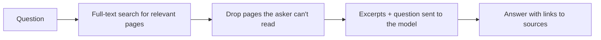

# AI Chat

JustWiki can connect to a large language model so people can ask the wiki questions in plain language — "What accounts does a new hire need?" It's optional and off by default.

## How it works



- **Grounded in your wiki (RAG)** — relevant pages are found with full-text search and their excerpts are given to the model; the answer ends with links to the pages it cited so you can check them
- **Permission-aware** — only pages the asker can read are sent to the model, so AI chat can't leak restricted pages
- **Streaming** — the answer appears as it's generated; click **Stop** at any time

Open **AI Chat** in the sidebar. Enter sends, Shift+Enter adds a new line.

## Enabling it

The server admin sets these in `.env`:

```
AI_ENABLED=true
AI_BASE_URL=https://generativelanguage.googleapis.com/v1beta/openai
AI_API_KEY=your-key
AI_MODEL=gemini-2.0-flash
```

Any OpenAI-compatible provider works — change `AI_BASE_URL` and `AI_MODEL`:

| Provider | AI_BASE_URL | Example AI_MODEL |
|----------|-------------|------------------|
| Gemini | `https://generativelanguage.googleapis.com/v1beta/openai` | `gemini-2.0-flash` |
| OpenAI | `https://api.openai.com/v1` | `gpt-4o-mini` |
| Ollama (local) | `http://localhost:11434/v1` | `llama3.1` (`AI_API_KEY=ollama`) |
| Groq | `https://api.groq.com/openai/v1` | `llama-3.3-70b-versatile` |
| DeepSeek | `https://api.deepseek.com` | `deepseek-chat` |

Other settings:

| Variable | Meaning | Default |
|----------|---------|---------|
| `AI_MAX_CONTEXT_PAGES` | Max pages included per question | `5` |
| `AI_EXCERPT_CHARS` | Max characters excerpted per page | `1500` |
| `AI_RATE_LIMIT_PER_HOUR` | Questions per user per hour | `20` |

:::warning
With AI chat on, excerpts of relevant pages are sent to the provider you configure. If your content must not leave your network, use a self-hosted model such as Ollama.
:::

:::info
This demo has no backend, so AI chat isn't available here.
:::
