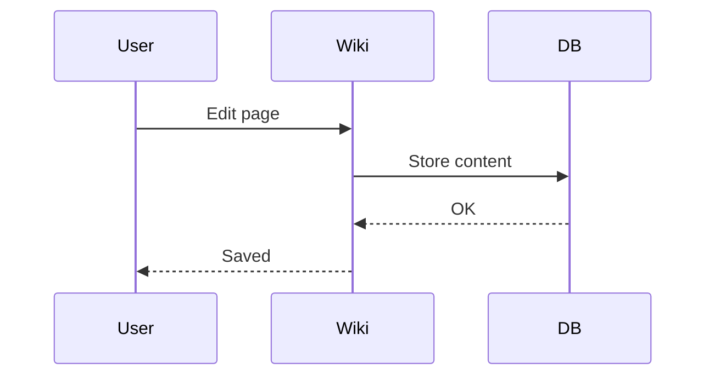

# Rich Content

Beyond plain text, a JustWiki page can hold callouts, diagrams, math and architecture drawings. Every example on this page is rendering live — compare it with the source shown above it.


## Callouts

Open with `:::kind` and close with `:::`. Anything in between is regular Markdown:

```
:::info
Callout content, with **Markdown** support.
:::
```

:::info
**Info** — background or supporting detail.
:::

:::tip
**Tip** — a shortcut or a good practice.
:::

:::warning
**Warning** — something that's easy to get wrong.
:::

:::danger
**Danger** — an action that can lose data or take a service down.
:::

## Mermaid diagrams

A code block tagged `mermaid` renders as a diagram: flowchart, sequence, class, state, gantt, pie and more.

````

````




## Math (KaTeX)

Inline math uses single dollar signs: `$E = mc^2$` → $E = mc^2$

Block math uses double dollar signs:

```
$$
\int_{-\infty}^{\infty} e^{-x^2} dx = \sqrt{\pi}
$$
```

$$
\int_{-\infty}^{\infty} e^{-x^2} dx = \sqrt{\pi}
$$

$$
\sum_{n=1}^{\infty} \frac{1}{n^2} = \frac{\pi^2}{6}
$$

## Draw.io diagrams

For free-form drawings — system architecture, network topology, UI flows — type `/drawio` in the editor to open the built-in Draw.io editor. Once saved, the page contains a `::drawio[id]` directive that renders as the diagram. Click the diagram later to reopen it in the editor; there are no image files to manage.

Every diagram is listed under **Admin → Library → Diagrams**, along with the pages that use it.

## Code blocks

Add a language name after the opening backticks for syntax highlighting:

````
```python
def hello():
    print("Hello, JustWiki!")
```
````

```python
def hello():
    print("Hello, JustWiki!")
```

```javascript
const greet = () => console.log("Hello!");
```

```bash
docker compose up -d
```
