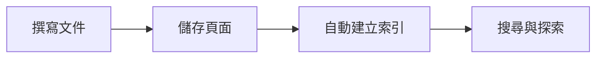
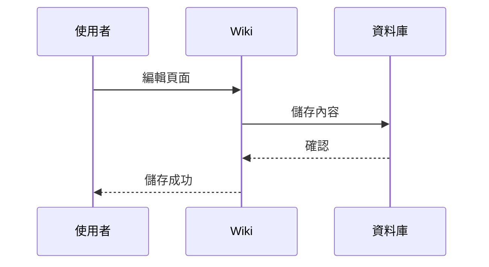

# 豐富內容

除了一般文字，JustWiki 頁面還能放提示框、圖表、數學公式和架構圖。這頁每個範例都是真的在渲染，可以對照下方的原始語法。


## 提示框（Callout）

用 `:::種類` 開頭、`:::` 結尾，中間可以放任何 Markdown：

```
:::info
提示框內容，支援 **Markdown**。
:::
```

:::info
**資訊** — 補充說明、背景知識。
:::

:::tip
**小提示** — 分享捷徑或好用的做法。
:::

:::warning
**警告** — 提醒容易踩到的地方。
:::

:::danger
**危險** — 標記會造成資料遺失或服務中斷的操作。
:::

## Mermaid 圖表

用 `mermaid` 標記的程式碼區塊會渲染成圖表，支援 flowchart、sequence、class、state、gantt、pie 等類型。

````

````




## 數學公式（KaTeX）

行內公式用單個錢號：`$E = mc^2$` → $E = mc^2$

區塊公式用兩個錢號：

```
$$
\int_{-\infty}^{\infty} e^{-x^2} dx = \sqrt{\pi}
$$
```

$$
\int_{-\infty}^{\infty} e^{-x^2} dx = \sqrt{\pi}
$$

$$
\sum_{n=1}^{\infty} \frac{1}{n^2} = \frac{\pi^2}{6}
$$

## Draw.io 圖表

需要自由繪圖（系統架構、網路拓撲、UI 流程）時，在編輯器輸入 `/drawio` 會開啟內建的 Draw.io 編輯器。存檔後頁面裡會出現 `::drawio[id]` 語法，檢視時渲染成圖。之後點擊圖表就能再次開啟編輯器修改，不用另外管理圖檔。

所有圖表都列在 **管理 → 媒體庫 → 圖表**，可以看出每張圖被哪些頁面使用。

## 程式碼區塊

在三個反引號後面加上語言名稱就有語法高亮：

````
```python
def hello():
    print("Hello, JustWiki!")
```
````

```python
def hello():
    print("Hello, JustWiki!")
```

```javascript
const greet = () => console.log("Hello!");
```

```bash
docker compose up -d
```
